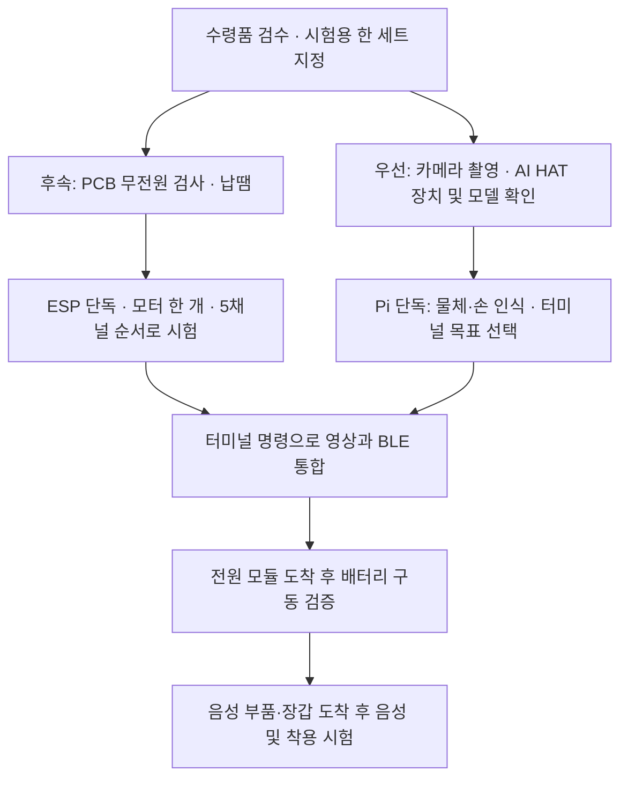

# 1차 부품 수령 및 실물 시험 계획

작성일: 2026-10-12

**현재 우선순위는 라즈베리파이의 표준 카메라 1대와 AI HAT+ 2로 물체·손 인식과 터미널 목표 선택을 실제로 구동하는 것이다.** 10월 12일 사용자 전달 결과로 카메라 촬영과 HAT 장치 식별까지 확인했다. ESP 쪽은 멀티미터 검사와 납땜 후 진행한다. 라즈베리파이 단독 시험에서는 음성과 BLE를 끄고 방향·근접도·5채널 계산 결과를 터미널에서 확인한다. 이후 영상 → BLE → 모터, 배터리·음성·착용 시험으로 확장한다.

### 10월 12일 실기기 진행 결과

| 항목 | 사용자 전달 결과 |
|---|---|
| OS / CPU 아키텍처 / Python | Debian 13 Trixie / aarch64 / Python 3.13.5 |
| 카메라 | `imx708` 장치 인식, 실제 촬영 후 사용자가 화질 확인 |
| AI HAT+ 2 | HailoRT CLI 5.1.1, 펌웨어 5.1.1, `HAILO10H` 식별 |
| 다음 작업 | 프로젝트 가상환경 import 검사, DFC 5.1.0 RGB YOLOv8n HEF와 손 모델 준비, 실제 추론 |

아래 시험 절차는 재현용으로 유지한다. 현재 완료된 것은 촬영·장치 식별까지이며, 물체·손 추론과 BLE·모터 시험은 아직 확인 전이다.

## 1. 도착한 것과 기다리는 것

출처: `00. 캡스톤 관련 문서/김가네 부품 정리.xlsx`, `Sheet1`. 제품명·수량 셀의 노란 배경 `#FFFF00`을 확인했고, 사용자가 이 항목들은 모두 도착했다고 설명했다. 아래 수량은 표의 기재 수량이며 실물 개별 검수 전이다. 번호만 노란색인 22~27행은 **아직 도착하지 않았다고 사용자 확인**했다. PCB도 도착했지만 실제 수령 장수·실장 상태는 검사해야 한다.

| 도착 품목 | 표 수량 | 근거 셀 | 지금 할 일 |
|---|---:|---|---|
| Raspberry Pi AI HAT+ 2 | 1개 | B2:C2 | Pi 장착, 장치 식별, 모델 실행 |
| Camera Module 3 표준형 | 1개 | B4:C4 | Pi 5용 케이블 확인, 촬영, 고정 위치 설정 |
| ESP32-C3 SuperMini | 3개 | B12:C12 | 한 개를 PCB 시험용으로 지정 |
| PN-VM102 코인 진동 모터 | 10개 | B13:C13 | 한 개 시험 후 5채널 구성, 나머지 예비 |
| AO3400A | 10개 | B14:C14 | PCBA에 이미 실장됐다면 예비·수리용으로 보관 |
| GY-521 / MPU6050 | 3개 | B15:C15 | 한 개의 전원·I²C 응답 확인 |
| 3.7V 1000mAh LiPo | 2개 | B16:C16 | 극성·보호회로·실제 전압 확인, 휴대 구동은 이후 |
| 3.7V 2000mAh LiPo | 2개 | B17:C17 | 동일 확인; 처음에는 한 팩씩 사용 |
| 주문 PCB/PCBA | 도착, 장수 미확인 | 사용자 설명 | 발주 도면과 실장·납땜 상태 대조 |

**미도착:** PRT-14411 충전/5V 승압 모듈 2개, USB 마이크 1개, USB 스피커 1개, 5000mAh 배터리 1개, 흰 장갑·회색 장갑 각 1묶음(표기상 각 10개). 카메라 와이드형은 도착 표시가 없으며, 이번 구성에는 도착한 표준형 한 대를 사용한다.

기존 Pi 5·SD·Tailscale 설정과 BLE LED 시험은 이전 작업을 활용한다. 새 모터·전원·카메라가 정상이라는 뜻은 아니므로 별도 확인한다.

## 2. 진행 순서



먼저 4장의 Pi 작업을 진행한다. 3장의 PCB 작업은 검사·납땜 준비가 끝난 뒤 진행하며, Pi 단독 개발을 막지 않는다. 단계별 완료 조건을 기록한다.

## 3. 동환: PCB와 장갑 디바이스

### 3-1. 전원을 넣기 전

- [ ] PCB 앞뒤를 촬영하고 시험 보드에 `G01`처럼 식별자를 붙인다.
- [ ] 발주 사진과 실제 부품을 대조한다. SS14 5개, AO3400A 5개, 저항 10개, 커패시터 4개의 실장 여부를 확인한다. 빈 PCB만 온 경우에는 실장부터 해야 한다.
- [ ] 납땜 브리지·빠진 부품·기울어진 부품·손상된 패드를 확인한다.
- [ ] USB·배터리·외부 전원을 모두 분리하고 전원–GND 사이의 지속적인 저저항 단락과 의도하지 않은 5V–배터리 레일 연결을 검사한다. 커패시터 충전 때문에 순간적으로 울리는 도통음만으로 단락 판정하지 않는다.
- [ ] SS14의 띠가 있는 K는 모터 +, A는 모터 −/MOSFET 드레인인지 확인한다.
- [ ] 모터 제어 GPIO와 패드가 아래 표와 연결되는지 확인한다.
- [ ] ESP와 GY-521을 가조립해 적층 간격, USB 접근, 금속부 접촉, 안테나 주변 공간을 확인한다.

| 채널 | GPIO | 모터 패드 |
|---|---:|---|
| 엄지 TH | 0 | TH+ / TH− |
| 검지 IN | 1 | IN+ / IN− |
| 중지 MI | 3 | MI+ / MI− |
| 약지 RI | 4 | RI+ / RI− |
| 소지 PI | 5 | PI+ / PI− |
| IMU SDA / SCL | 6 / 7 | GY-521 SDA / SCL |

근거: [발주 회로·배치 기록](2026-10-04_장갑_햅틱_PCB_발주_및_조립_준비.md). 펌웨어의 GPIO 배열은 일치하지만 실물 배선 검증은 아직 하지 않았다.

### 3-2. 첫 전원 시험과 모터 한 개 시험

**충전·승압 모듈 미도착 상태에서 가능한 시험 구성:** ESP는 USB로 전원 공급, 모터 레일은 실험실의 전류 제한 가능한 DC 전원으로 공급하고 GND를 공통 연결한다. 외부 5V는 동시에 연결하지 않는다. 전류 제한 전원이 없다면 빌리거나 준비할 때까지 무전원 검사·USB 단독·Pi 작업을 먼저 진행한다.

1. 모터와 GY-521을 연결하기 전 ESP USB 단독 부팅·시리얼·BLE를 확인한다. 필요하면 먼저 PCB 밖에서 ESP 자체를 확인한다.
2. ESP `3V3`와 PCB의 각 전원 레일 전압을 확인한다. 모터 전원을 ESP `3V3`에서 공급하지 않는다.
3. 첫 모터 시험은 **GY-521 미연결**, 모터 한 개만 연결하고 모터 레일을 PN-VM102의 기준 전압인 3V부터 시험한다. 전류 제한값은 모터 기동 전류와 공급기 계측에 맞춰 정하고 기록한다. 기동하지 않는다고 무작정 전압부터 높이지 않는다.
4. 해당 채널만 짧게 ON/OFF하여 다른 채널이 켜지지 않는지, OFF 후 멈추는지, ESP가 재부팅되지 않는지 확인한다.
5. 같은 방법으로 나머지 채널을 하나씩 검사하고, 한 개 → 두 개 → 다섯 개 동시 구동 순서로 확대한다.

발주 도면의 전원 입력은 **PCB 윗면 기준 왼쪽부터 5V / 배터리 전압 레일 / GND**다. 실크의 `3`을 ESP `3V3` 출력과 혼동하지 않도록 실물 도통 검사 후 배선에 이름을 붙인다. USB 연결 시 PCB 5V 레일도 살아날 수 있으므로 외부 5V 공급은 분리한다.

현재 [haptic_receiver](../esp32_device/firmware/haptic_receiver/README.md)는 `DRY_RUN=true`라서 모터를 돌리지 않는다. 회로 검사가 끝난 뒤에만 모터 출력 모드로 전환한다. 이전 `ble_led_control.py`는 새 수신기의 UUID·패킷과 호환되지 않는다.

**다음 코드 작업:** 카메라 없이 채널별 세기·짧은 동작 시간을 지정하고 항상 OFF로 끝나는 모터 시험 스케치 또는 수동 BLE 시험 도구가 필요하다. 현재 저장소에는 전용 수동 5채널 시험 도구가 없어, 기존 LED 명령으로 모터 시험이 된다고 안내하지 않는다. 이번 작업에서는 시험 계획만 정리했다.

**완료 조건:** TH~PI가 각각 올바른 모터만 구동하고, 부팅·정지·통신 만료 시 OFF이며, 다섯 개 구동 중 ESP 리셋·이상 발열·전원 강하 문제가 없어야 한다. 가능하면 오실로스코프로 기동 순간도 확인한다. 멀티미터의 평균 전압만으로 짧은 전압 강하까지 없다고 단정하지 않는다.

### 3-3. IMU는 개별 확인 후 추가

GY-521의 실제 레귤레이터·VCC 입력 조건과 SDA/SCL 풀업 전압을 확인한 후 GPIO6/7에 연결한다. 모듈용 입력과 MPU6050 칩 자체의 입력을 혼동하지 않는다. 특히 최종 배터리 레일은 완충 시 약 4.2V이므로 I²C HIGH 전압이 ESP 허용 범위를 넘지 않는지 확인한다.

AD0=GND이면 I²C 주소 `0x68` 응답을 기대한다. 이후 정지 상태·기울임·모터 구동 중 센서값을 비교한다. 현재 수신 펌웨어에는 IMU 읽기나 자세 보정 기능이 없다. 모터·비전 기본 동작을 먼저 검증하고 IMU를 붙인다.

## 4. 해수·민주: 카메라와 AI HAT 실기기 구동

### 4-1. 준비물과 장착

- [ ] **Pi 5용 22핀 ↔ Camera Module 3용 15핀 카메라 케이블**이 있는지 확인한다. 카메라에 들어 있는 기본 케이블만으로 맞지 않을 수 있다.
- [ ] Pi 전원·냉각·HAT 고정 부품과 PCIe 케이블을 확인한다.
- [ ] Pi를 종료하고 전원을 분리한 뒤 카메라를 연결하고 HAT를 장착한다.
- [ ] 카메라를 책상 위에 고정하여 손과 목표 물체가 한 화면에 들어오게 한다. 일단 표준 카메라 한 대로 진행한다.

연결 근거: [Raspberry Pi 카메라 설치 안내](https://www.raspberrypi.com/documentation/accessories/camera.html), [AI HAT 설치 안내](https://www.raspberrypi.com/documentation/accessories/ai-hat-plus.html).

### 4-2. 프로젝트 실행 전에 장치부터 확인

Pi에서 다음을 실행한다. 기존 환경을 지우거나 가상환경을 다시 만들기 전에 설치 상태부터 본다.

```bash
cat /etc/os-release
uname -m
hailortcli --version
hailortcli fw-control identify
rpicam-hello --list-cameras
mkdir -p /tmp/kimgane-bringup
rpicam-still -n -t 2000 -o /tmp/kimgane-bringup/camera-test.jpg
```

`HAILO10H` 장치 식별과 카메라 사진 저장·실제 사진 내용을 각각 확인한다. SSH에서는 사진을 PC로 가져오거나 원격 데스크톱에서 열어 본다. `-n`은 미리보기 없이 촬영하는 옵션이다.

장치 패키지가 없다면 [VISION_SETUP](../Raspi5_vision/VISION_SETUP.md)과 [공식 AI 설치 안내](https://www.raspberrypi.com/documentation/computers/ai.html)를 따른다. AI HAT+ 2는 `hailo-h10-all` 대상이며, Hailo-8/8L의 `hailo-all`과 구분한다. 기존 설치 버전과 모델 호환성을 확인하고, 모든 패키지를 무조건 재설치하지 않는다.

### 4-3. 음성·실제 BLE 없이 비전 확인

모델 파일과 프로젝트 가상환경이 준비된 후:

```bash
cd "$HOME/Desktop/kimGA_raspi/microprocessor-capstone-design/03. 김가네 캡스톤 디자인/Raspi5_vision"
source .venv/bin/activate
python -m haptic_mvp doctor --deep --console
python -m haptic_mvp run --console
```

`doctor` 통과는 실제 추론 성공이 아니다. 실행 후 컵·물병 등 목표 한 개와 손을 보여주고 `컵 찾아줘`, `정지`를 입력해 상태 변화를 확인한다. 현재 설정은 `show_preview=false`이므로 화면이 안 뜨는 것 자체는 오류가 아니다. Pi 데스크톱에서 영상 확인이 필요하면 로컬 설정으로 미리보기를 켠다.

**완료 조건:** 실제 HAT에서 탐지, 손 좌표 출력, 사용자 기준 좌우/앞뒤 확인, 손·목표가 안 보일 때 안내 중지. 처리 속도·지연은 이번 실기기에서 측정한다. 모터가 탑재된 장갑 착용 시 손 추적 성능은 이후 별도 확인한다.

## 5. 두 작업이 끝나면 BLE 통합

1. ESP에 `haptic_receiver`를 올리되 먼저 `DRY_RUN=true`로 확인한다. 장치 이름은 `KIMGANE-HAPTIC`이다.
2. Pi에서 `python -m haptic_mvp run --console --ble`를 실행한다. 이 명령의 `--ble`는 실제 전송을 켜지만 ESP의 `DRY_RUN`을 바꾸지는 않는다.
3. 수신된 5채널 값과 내장 LED, 목표 변경·정지·연결 해제 후 출력 상태를 확인한다.
4. PCB 개별 채널·전원 시험을 통과했으면 ESP 모터 모드로 전환하여 같은 흐름을 책상 위에서 반복한다.
5. 송신 중단·Pi 프로그램 종료·BLE 연결 끊김 때 실제 모터가 꺼지는지 확인한다. 기본 TTL 500ms는 마지막 유효 명령 수신 이후의 설정값이며, 사용자 발화부터 OFF까지의 보장 지연은 아니다.

**1차 통합 성공:** 키보드로 목표 선택 → 손 위치에 따른 채널 변화 → 모터 반응 → 정지/추적 실패 시 출력 OFF. 카메라 기반 실거리는 측정하지 않으므로 cm나 자동 잡기 완료로 표시하지 않는다.

10월 7일 UX 문서의 명시적 시작·재개·독립 중지 등은 설계안이다. 현재 코드는 손이 다시 보일 때 자동 재개할 수 있고, TTS 중에는 음성 입력을 버린다. 사람에게 착용시켜 안내하는 단계 전에 이 차이를 수정·검증한다.

## 6. 나머지 부품 도착 후

| 부품 | 다음 작업 | 완료 조건 |
|---|---|---|
| PRT-14411 | 극성·충전 조건 확인 → 모듈 단독 5V 출력 → PCB 연결 → 부하 시험 | USB 제거 상태에서도 ESP·모터 동작, 과전류·발열·리셋 없음 |
| USB 마이크·스피커 | OS 장치 인식 → 녹음·재생 → STT/TTS 단독 → 통합 | 명령 인식과 실제 소리 출력, 독립 중지 경로 확보 |
| 장갑 | 모터 임시 고정 → 손가락 매핑 → 장갑 낀 손 인식 → 착용 수정 | 채널 구별, 손끝 감각·움직임·배선 당김에 큰 방해 없음 |
| 5000mAh 배터리 | 장착 위치·무게 비교, 해당 팩 보호회로와 정격 확인 | 필요할 때 채택; 먼저 온 1000/2000mAh로 장갑 전원 시험 가능 |

최종 전원은 기존 합의대로 **배터리 한 팩에서 병렬 분기하여 5V 승압 → ESP 5V, 원 배터리 전압 → 모터/GY-521 전원 레일**로 검토한다. 서로 다른 배터리 팩을 병렬로 묶는다는 뜻은 아니다. GY-521 레귤레이터와 I²C 전압 검증은 전제 조건이다. 첫 배터리 시험은 충전하지 않는 상태로 진행하고, 충전 중 사용은 모듈의 부하 분담·충전 종료 조건을 확인한 뒤 검토한다.

스피커의 ‘USB’가 전원만 뜻하는지 USB 오디오 입출력까지 뜻하는지 확인한다. 실제 `aplay -l`의 출력 장치와 입력 커넥터를 보고 추가 오디오 인터페이스 필요 여부를 결정한다. [기존 음성 시험 절차](../Raspi5_vision/AUDIO_SETUP.md)를 이용한다.

지속시간은 배터리 용량만으로 확정하지 않는다. 배터리 쪽 평균 전류를 대기/BLE/모터 1개/5개/실제 안내 패턴에서 측정하고, `용량(mAh) ÷ 배터리 측 평균 전류(mA)`를 1차 추정치로 기록한다. 실제 종료 전압·변환 손실·사용 가능한 용량을 반영한 구동 시간 시험으로 확인한다.

## 7. 오늘 할 일과 남길 기록

| 담당 제안 | 첫 작업 | 오늘의 확인 결과 |
|---|---|---|
| 김동환 | PCB 한 장 실장·단락·핀 순서 검사, ESP USB 부팅 | 앞뒤 사진, 검사표, 전원 측정값 |
| 김해수 | 표준 카메라·AI HAT 장착 및 식별, 모델 실행 준비 | 사진 1장, Hailo 식별 로그, 버전 |
| 김민주 | 실제 카메라로 맨손 추적·방향 확인, 미도착 음성 부품 시험 준비 | 손 검출·가림 로그, 음성 시험 절차 |
| 공동 | 수동 5채널 시험 코드 준비 후 모터 한 개 검증 | 채널·세기·시간·전류·리셋 유무 |

역할은 기존 분담을 바탕으로 한 제안이다. **오늘은 카메라/HAT 장착·인식 성공부터 목표로 잡는다.** 이어 음성·BLE 없이 컵과 손의 인식, 목표 선택, 방향 계산을 확인한다. 동환도 우선 Pi 환경·로그 점검에 참여하며, PCB 검사는 후속 작업으로 진행한다.

| 시험 | 보드/부품 ID | 공급 전압 | 전류·전압강하 | 결과·오류 | 다음 조치 |
|---|---|---|---|---|---|
| ESP USB 단독 | | | | | |
| 모터 1채널 | | | | | |
| 모터 5채널 | | | | | |
| GY-521 응답 | | | | | |
| 카메라/HAT | | | | | |
| BLE 정지/만료 | | | | | |

장비·소모품 보유도 확인한다: 멀티미터, 전류 제한 DC 전원, 인두·납·플럭스, 배선·절연재, 모듈 핀헤더/소켓·스페이서, 카메라 고정대, Pi 5용 카메라 케이블. 부족한 것만 준비한다.

## 참고

- [PN-VM102 설명서](https://www.eleparts.co.kr/data/goods_old/design/product_file/Hoon/PN-VM102-K.pdf): 기준 전압 3V, 사용 범위 2~5V. 실제 구매품의 모델을 대조한다.
- [Raspberry Pi 카메라 소프트웨어](https://www.raspberrypi.com/documentation/computers/camera_software.html): 장치 목록·미리보기 없는 촬영.
- [Raspberry Pi AI 소프트웨어](https://www.raspberrypi.com/documentation/computers/ai.html): HAT+ 2 설치·장치 확인.
- [발주 도면과 전원 계획](2026-10-04_장갑_햅틱_PCB_발주_및_조립_준비.md): IMU 데이터시트와 GPIO 전압 근거 포함.

이 문서는 수령 사실, 사용자가 전달한 Pi 촬영·HAT 식별 결과와 앞으로의 시험 계획을 정리한 것이다. 에이전트가 Pi에 직접 접속한 것은 아니며, 실제 PCB 통전·모터 구동 통과는 아직 확인하지 않았다.
