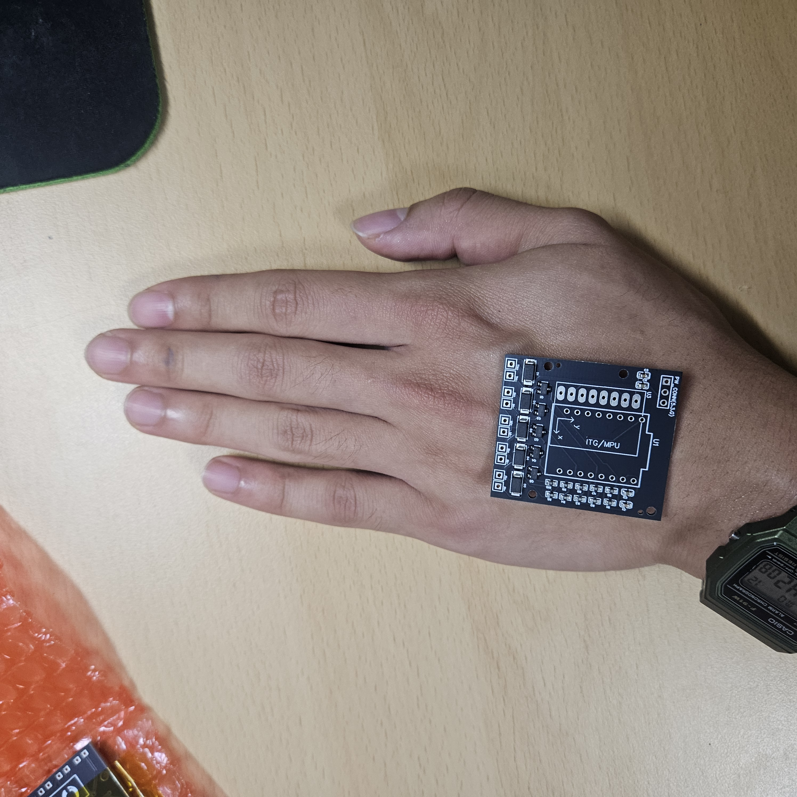
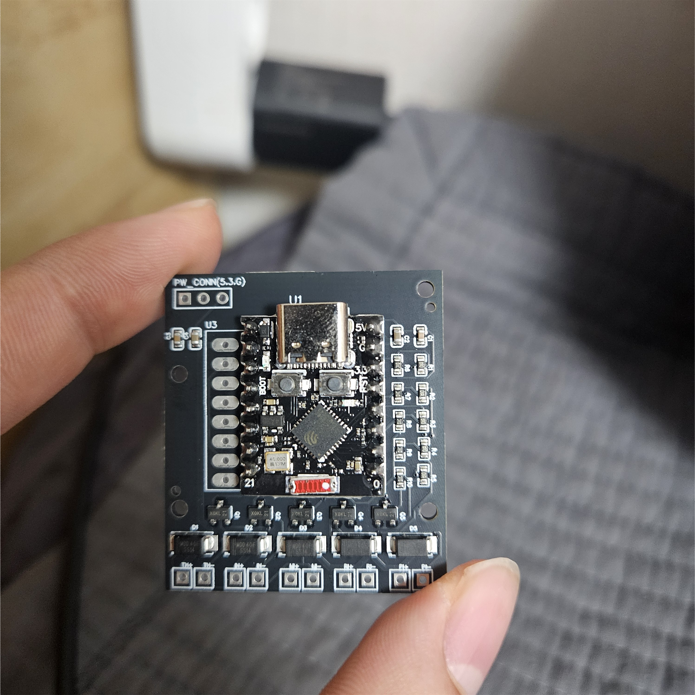
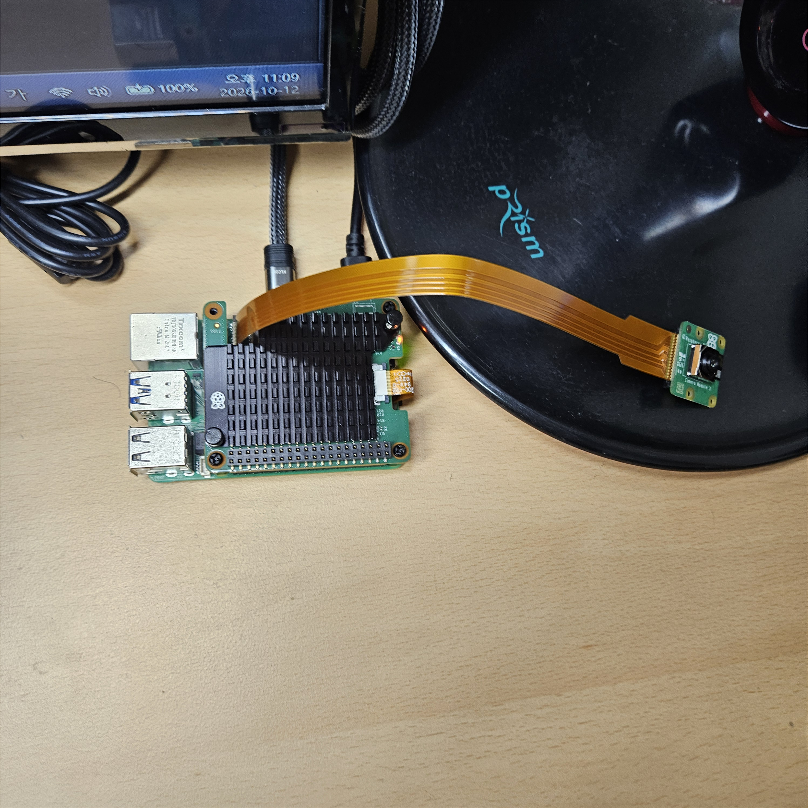
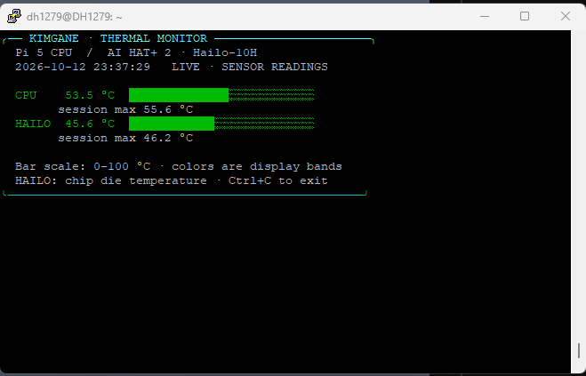
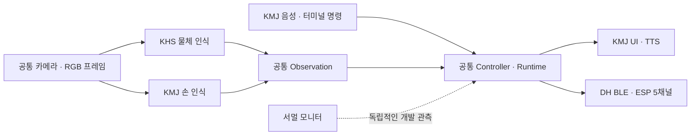

# 실물 셋업 진행 기록 및 main 구성안

- 작성일: 2026-10-12
- 작성자: 김동환(DH)
- 근거: 오늘 전달된 Pi 터미널 결과, 실물 사진, 서멀 모니터 화면, 팀 대화 및 기존 역할 분담 문서
- 문서 성격: 오늘의 확인 결과 + 협업·통합 구조 제안

**오늘은 카메라 실제 촬영, AI HAT+ 2 장치 식별, CPU·Hailo 온도 동시 조회까지 확인했다. PCB는 수령 후 크기와 배치를 확인하고 ESP32 모듈 납땜을 진행한 상태다. 다음 목표는 라즈베리에서 물체·손 인식을 실행하고, 팀원별 코드를 공통 실행 경로에 연결하는 것이다.**

팀 대화는 결정 사항과 일정으로 정리했다. 대화창 이미지는 이 문서에 넣지 않았으며, 실물 사진 3장과 서멀 모니터 화면 1장만 첨부한다.

## 1. 오늘 확인한 상태

| 항목 | 확인 결과 | 아직 확인할 것 |
|---|---|---|
| Pi 실행 환경 | Debian 13 Trixie, aarch64, Python 3.13.5 | 프로젝트 가상환경에서 SDK import/API 검사 |
| 표준 Camera Module 3 | `imx708` 인식, 실제 사진 촬영, 사용자 화질 확인 | 고정된 책상 배치에서 추론 입력 확인 |
| AI HAT+ 2 | HailoRT CLI·펌웨어 5.1.1, `HAILO10H` 식별 | HEF 로딩·실제 물체 추론 |
| 서멀 모니터 | CPU·Hailo 실제 센서값 동시 표시 | 추론 중 온도·지연 변화 측정 |
| PCB | 수령, 손등 위 크기 비교, SMD 실장 상태 확인 | 멀티미터 검사와 전원·채널 시험 |
| ESP32 모듈 | PCB 위 배치·납땜 진행 사진 확인 | 납땜부 도통·단락, 보드 부팅 확인 |
| GY-521·모터 배선 | 사진에서 모듈·모터 배선 미장착 | 전원 조건 확인 후 연결·시험 |
| 마이크·스피커·전원 모듈 | 이번 확인 기준 미도착 | 도착 후 음성·배터리 시험 |

사진으로 확인한 조립 상태와 전기적 정상 동작은 별개로 기록한다. PCB의 단락 검사, 모터 구동, IMU 응답을 통과했다고 판단할 결과는 아직 없다. 과거 ESP 단독·BLE LED 성공 기록도 이번 PCB 통전 결과를 대신하지 않는다.

### Pi 환경과 HAT 식별 결과

```text
OS: Debian GNU/Linux 13 (trixie)
Architecture: aarch64
Python: 3.13.5
Camera: imx708 [4608x2592 10-bit RGGB]

HailoRT-CLI version 5.1.1
Executing on device: 0001:01:00.0
Control Protocol Version: 2
Firmware Version: 5.1.1 (release,app)
Device Architecture: HAILO10H
```

처음에는 `hailortcli: command not found`였으며, 이후 사용자가 전달한 출력으로 CLI 실행과 실제 HAT 장치 식별을 확인했다. 카메라는 미리보기 없이 촬영할 수 있었고, 사용자가 결과 사진의 화질이 깨끗하다고 확인했다.

모델 준비는 Hailo Model Zoo v5.1.0의 RGB YOLOv8n HEF와 MediaPipe Hand Landmarker를 대상으로 안내했다. 현재 최신 모델 목록의 5.4.0 파일을 그대로 사용하는 대신 실제 설치된 5.1.1 스택에 맞춰 첫 시험 대상을 선택했다. **다운로드·`parse-hef`·모델 생성·추론 성공 결과는 아직 전달받지 않았다.**

설치 및 모델 준비 명령은 [VISION_SETUP](../Raspi5_vision/VISION_SETUP.md)에 정리되어 있다.

## 2. 실물 조립과 배치 기록

### PCB 크기와 손등 배치



PCB를 손등 위에 놓아 크기와 위치를 비교했다. 실제 장갑 고정, 모터 배선, 배터리 장착 전의 배치 확인 단계다. 모듈까지 장착한 높이, 손목 움직임, 케이블 당김과 손 추적 가림은 착용 시제품에서 추가 확인한다.

### ESP32-C3 SuperMini 장착·납땜 진행



PCB에 ESP32-C3 SuperMini가 배치되어 있고 양측 접합부에 납땜을 진행한 모습이 보인다. 사진에서 전원 입력과 모터 배선은 연결되어 있지 않다. USB 접근과 실제 핀 연결은 멀티미터 검사·부팅 시험으로 확인해야 한다.

수요일에는 접합부와 전원 레일을 점검하고, 파워서플라이를 이용해 모터 약 2개의 구동을 먼저 확인할 예정이다. 납땜 외관만으로 전기적 정상 여부를 확정하지 않는다.

### Pi·AI HAT+ 2·카메라 연결



사진에서 Pi 위 HAT와 방열판, 카메라 케이블과 카메라의 연결 상태를 확인했다. 이 구성에서 카메라 촬영과 HAT 식별 결과를 얻었다. Pi CPU 쿨러의 설치 여부는 이 사진만으로 확정하지 않는다.

카메라가 현재 책상에 놓인 상태이므로, 다음 영상 시험 전에 **손과 목표 물체를 함께 보는 고정 위치**를 마련한다. 팀 대화에서도 카메라를 장착할 수 있는 케이스·거치 구조를 빠르게 조사하기로 했다.

## 3. 서멀 모니터 실측 결과



| 항목 | 화면의 현재 온도 | 해당 실행 세션 최고 온도 |
|---|---:|---:|
| Pi CPU | 53.5°C | 55.6°C |
| Hailo-10H | 45.6°C | 46.2°C |

- 화면 시각: 2026-10-12 23:37:29
- 화면 모드: `LIVE · SENSOR READINGS`
- 부하 조건: 사용자가 **기본적으로 켜 둔 상태**라고 설명했다. YOLO·손 추적·STT를 동시에 실행한 부하 시험 결과가 아니다.
- 최고 온도는 이 모니터 실행 세션에서 관측한 최고값이며, 장시간 운용 전체의 최고값이 아니다.

CPU와 Hailo 온도 동시 조회가 실제 Pi에서 동작함을 확인했다. Hailo 값은 HAT 표면 온도가 아닌 칩 내부 온도다. 녹색·노란색·빨간색과 0~100°C 막대는 표시 규칙이며 제조사의 안전 한계를 뜻하지 않는다.

모니터 코드는 [thermal_monitor.py](../Raspi5_vision/tools/thermal_monitor.py)에 있다. 기본 2초 간격으로 갱신하고 최고 온도를 표시하며, 센서 조회 실패 시 `N/A`와 오류를 출력한다. 호스트에서 표시·오류 처리 테스트 8개를 통과했고, 사용자 실측 화면으로 CPU·Hailo 실제 조회를 확인했다.

**냉각에 대한 의견:** 지속적인 영상 추론과 이후 음성 처리를 위해 Pi 5의 Active Cooler와 AI HAT+ 2 방열판을 갖추는 방향을 권장한다. 현재 값은 대기 기준값으로 남기고, 실제 추론을 약 10~15분 실행하며 온도·처리 시간·프레임 만료를 함께 관찰한다. 대기 온도만으로 연속 추론 성능을 판단하지 않는다. [공식 냉각 안내](https://www.raspberrypi.com/documentation/accessories/ai-hat-plus.html)

## 4. 팀 대화에서 정리한 사항과 일정

대화에 등장하는 ‘오늘·내일·수요일’은 2026-10-12를 기준으로 날짜를 풀어 적었다. 구현 폴더와 통합 방식은 다음 장의 제안으로 구체화하며, 이미 적용된 구조로 표시하지 않는다.

| 일정 | 내용 | 담당·상태 |
|---|---|---|
| 10/12(월) | 오늘 셋업 과정과 확인 결과를 문서로 공유 | 김동환, 본 문서 작성 |
| 10/13(화) 22:00까지 | 각자 작업한 내용과 코드를 본인 브랜치에 push | 김해수·김민주 포함 각 담당자 |
| 가능한 한 빠르게 | Pi와 카메라를 함께 설치할 케이스·거치 구조 조사 | 팀원 중 담당 선정 필요 |
| 10/14(수) 약 17:00부터 | 멀티미터 PCB 검사, 납땜 작업, 파워서플라이로 모터 약 2개 시험 | 김동환 중심, 팀 참여 시간 확보 요청 |

수요일 시작 시각은 대화에서 ‘아마 오후 5시부터’로 제시된 예정 시간이다. 확정된 예약 시간으로 취급하지 않는다.

팀원별 코드는 `Raspi5_vision` 안에서 이니셜과 역할이 드러나는 폴더로 관리하고, 김동환이 PR을 검토해 `main`에 통합하는 방향을 논의했다. 역할은 [9월 29일 회의록](2026-09-29_역할분담_회의록.md)의 확정 내용을 따른다.

## 5. main 구성에 대한 의견

**담당별 폴더를 두는 방식에 동의한다. 동시에 공통 실행 프로그램과 데이터 형식을 먼저 고정하는 것이 좋다.** 팀원이 만든 기능을 쉽게 찾을 수 있고, 실제 Pi에서 확인한 기능부터 순서대로 합칠 수 있기 때문이다.

지금 `haptic_mvp`에는 목표 선택·방향 계산·BLE·종료 처리·시뮬레이션이 이미 있다. 이것을 통합 기준으로 활용하면서 물체 인식, 손 인식, 음성·UI 구현을 교체 가능한 모듈로 연결하는 편이 작업량과 충돌을 줄인다. 완성된 기존 코드를 각자의 폴더로 통째로 복제하면 수정본이 여러 개 생기므로, 담당 기능과 연결 지점을 구체적으로 정한다.

### 제안하는 폴더 구성

아래는 **향후 main에 적용할 구성안**이다. 이 문서 작성 과정에서 기존 코드 이동, 폴더 개편, main 전환·merge는 수행하지 않았다.

```text
03. 김가네 캡스톤 디자인/
├── Raspi5_vision/
│   ├── README.md                  # 설치·실행·통합 상태
│   ├── VISION_SETUP.md
│   ├── AUDIO_SETUP.md
│   ├── haptic_mvp/                # 공통 실행·데이터·판단·통신
│   │   ├── __main__.py            # 전체 프로그램의 실행 진입점
│   │   ├── runtime.py             # 병행 실행·중지·오류·종료
│   │   ├── models.py              # Detection / Hand / Observation / Decision
│   │   ├── vision.py              # 공통 카메라 입력·영상 파이프라인
│   │   ├── controller.py          # 목표 선택·방향·근접도·상태
│   │   ├── audio.py               # 음성 모듈 연결·수명 관리
│   │   ├── ble_link.py
│   │   ├── protocol.py
│   │   └── ...                   # doctor·config·simulation 등
│   ├── KHS_object_detection/      # 김해수: 물체 인식
│   │   ├── __init__.py
│   │   ├── detector.py
│   │   └── README.md
│   ├── KMJ_hand_audio_ui/         # 김민주: 손 인식·음성·화면
│   │   ├── __init__.py
│   │   ├── hand_tracker.py
│   │   ├── speech.py
│   │   ├── ui/
│   │   └── README.md
│   ├── DH_integration/            # 김동환: 담당 모듈 연결·통합 시험
│   │   ├── __init__.py
│   │   ├── adapters.py
│   │   └── README.md
│   ├── config/                    # 공통 기본값·Git 제외 로컬 설정
│   ├── models/                    # 모델 파일 위치·라벨, 가중치는 Git 제외
│   ├── tools/                     # 서멀 모니터 등 개발 도구
│   ├── tests/                     # 공통·담당별·통합 시험
│   └── requirements-pi.txt        # 공통 Pi 의존성
├── esp32_device/firmware/         # 김동환: 수신기·모터 제어
└── docs/
    ├── 날짜_이니셜_맡은파트.md
    └── assets/날짜/               # 해당 기록에 쓰는 실물·결과 사진
```

루트 README는 기존 요청대로 전반적인 프로젝트 소개를 유지하고, 개발 절차와 폴더 설명은 `Raspi5_vision/README.md` 및 담당 폴더 README에 둔다. Linux에서 폴더 이름은 대소문자를 구분하므로 Python import와 실제 폴더명을 동일하게 사용한다.

### 담당별 경계

| 담당 | 맡을 구현 | 공통 프로그램에 전달할 결과 |
|---|---|---|
| 김해수(KHS) | Hailo 물체 추론, 전처리·좌표 복원, 클래스·성능 검증 | `Detection` 목록 |
| 김민주(KMJ) | 손 대표점, 손 좌우 판단, STT·TTS·UI | `Hand` 또는 `None`, 사용자 명령; 화면은 공통 상태 구독 |
| 김동환(DH) | 모듈 연결, 목표·방향 계산, BLE·ESP, 통합·전원 시험 | `Observation` → `Decision` → 5채널 명령 |

`DH_integration/adapters.py`는 담당 모듈을 공통 데이터 형식으로 연결하는 얇은 계층으로 둔다. 목표 선택이나 BLE 송신을 다시 구현하지 않는다. 담당 모듈이 `runtime`까지 역으로 import하지 않도록, 공통 데이터 타입만 참조하는 방향으로 연결한다.

각자의 README에는 입력·출력·실행 예제·실기기 검증 범위·알려진 문제를 적는다. `tests/` 안에는 담당을 식별할 수 있는 파일명으로 시험을 추가하고, 전용 실험 스크립트가 필요하면 해당 담당 폴더에서 관리한다.

## 6. 통합 전에 합의할 데이터 형식

현재 코드의 `models.py`를 우선 기준으로 삼는다. 새 필드가 필요하면 공통 타입 변경을 먼저 검토하고 담당 모듈을 함께 수정한다.

| 데이터 | 기준 |
|---|---|
| 카메라 입력 | 공통 카메라가 캡처한 동일한 RGB 프레임을 두 인식기에 전달 |
| 프레임 식별 | `frame_id`와 `captured_at`을 함께 전달. 시각 기준은 호스트 단조 시계 |
| 물체 | `Detection(label, box, score)`; box는 원본 영상 기준 `(x1, y1, x2, y2)`, 0~1 정규화 |
| 손 | `Hand(point, score, handedness)` 또는 `None`; 대표점은 원본 영상 기준 0~1 정규화 |
| 합쳐진 관측 | `Observation(frame_id, captured_at, objects, hand)` |
| 판단 결과 | `Decision(state, reason, target, direction, proximity, levels, speech)` |
| 진동 출력 | `levels` 5개, 기존 펌웨어와 동일한 채널 순서와 패킷 형식 |

MediaPipe의 기존 `Hand.score`는 손 좌우 분류 점수다. 관절 좌표 정확도나 검출 확률과 혼용하지 않는다. 새 손 모델을 연결할 때도 점수의 의미를 먼저 정의한다.

**카메라는 전체 실행에서 한 번만 연다.** 각자 카메라를 여는 스크립트는 단독 시험용으로 사용할 수 있지만, 통합 시에는 공통 프레임을 받는 함수·클래스로 연결한다. 모델별 리사이즈·패딩·ROI를 적용했다면 최종 좌표는 원본 영상으로 되돌려야 한다. 반전·회전도 두 인식기의 좌표 기준이 같게 적용한다.

물체 인식과 손 인식이 서로 다른 시점의 결과를 섞지 않도록 공통 프레임에서 관측을 완성한다. 추후 병렬 추론을 도입할 때는 `frame_id`를 맞추고 오래된 결과를 버린다. 입력이 쌓여 안내가 늦어지는 구조를 피한다.

UI는 공통 `Decision`과 장치 상태를 표시하고, 사용자 요청은 공통 명령 처리로 전달한다. UI가 별도 목표 상태를 갖거나 직접 모터를 켜는 구조로 만들지 않는다. 즉시 중지, 명시적 시작·재개 등 [접근성 UX 명세](2026-10-07_DH_접근성_UX_구현명세.md)의 요구는 별도 구현·검증 항목으로 관리한다.



처음에는 `python -m haptic_mvp run --console` 실행 경로를 유지한다. 담당 모듈 연결은 현재 하드웨어를 구동할 수 있는 코드부터 작게 교체하고 검증한다.

## 7. 브랜치와 main 통합 순서

`main`은 팀이 공통으로 실행할 기준 버전으로 두고, 각자는 최신 main에서 `본인 GitHub 아이디/작업 날짜` 브랜치를 만든다. 김동환은 기존 합의인 `DH-1279/YYYY-MM-DD`를 사용한다.

1. **공통 구조 PR:** 폴더 기본 틀·데이터 계약·README를 먼저 마련한다. 기존 명령 실행과 시뮬레이션이 유지되는지 확인한다.
2. **김해수 PR:** 물체 인식 모듈과 단독 검증 결과를 올린다. HAILO10H HEF·라벨·좌표 복원·추론 로그를 확인한다.
3. **김민주 PR:** 손 인식 연결부터 올리고, 음성·UI는 준비된 기능별로 나눠 연결한다. 마이크 미도착 상태에서는 터미널 입력으로 검증한다.
4. **김동환 통합 PR:** 공통 프레임에서 두 결과를 합치고 목표 선택·정지·프레임 만료를 시험한다. PCB 확인 후 실제 BLE·모터를 연결한다.

모든 PR은 main을 대상으로 하고 김동환이 검토한다. 한 PR이 merge되면 다음 PR은 최신 main 변경을 반영하고, 겹치는 공통 파일과 테스트 결과를 다시 확인한 뒤 merge한다. 기능 간 의존성이 있으면 PR 설명에 먼저 필요한 PR을 명시한다.

10월 13일 제출에는 코드와 함께 **실행 명령, 확인 결과, 남은 문제**를 담은 `docs/2026-10-13_이니셜_맡은파트.md`를 포함한다. Pi의 `.venv`, 개인 장치 설정·캐시·모델 가중치는 commit하지 않는다. 모델은 다운로드 출처·컴파일 버전·파일 경로를 기록한다.

merge 판단은 ‘폴더에 코드가 올라왔다’가 아니라 다음을 기준으로 한다.

- 담당 모듈이 합의한 입력·출력 형식을 지킨다.
- Pi에서 확인한 실행 명령과 결과가 있고, 미검증 영역도 표시되어 있다.
- 기존 6개 시뮬레이션과 변경 부분의 의미 있는 테스트가 통과한다.
- 카메라 중복 열기·종료 실패·오래된 입력·정지 후 출력 유지 문제가 없다.
- 통합 실행 명령이 유지되고 설치·모델 요구가 문서에 반영된다.

이번 날짜별 문서 작성은 구성안 제시까지이며, 팀 브랜치에 대한 승인이나 실제 main 개편·merge 완료를 뜻하지 않는다.

## 8. 다음 작업

| 순서 | 작업 | 완료 증거 |
|---|---|---|
| 1 | 카메라 거치 위치와 케이스·냉각 구성 조사 | 카메라 시야·모듈 간격·배선 접근 확인 |
| 2 | 가상환경·HEF·손 모델 준비 | `doctor --deep --console`, 모델 생성·추론 로그 |
| 3 | 컵·맨손으로 Pi 단독 실행 | 목표 선택, 방향 계산, 손·목표 가림, 정지 결과 |
| 4 | 담당 폴더 틀과 데이터 계약을 PR로 적용 | 기존 실행 유지, 담당별 연결 지점 명시 |
| 5 | 팀원 코드 검토·순차 통합 | 같은 프레임의 물체·손 결과와 공통 상태 확인 |
| 6 | 수요일 PCB 검사·모터 2개 시험 | 핀·단락·전압·전류·OFF·리셋 유무 기록 |
| 7 | BLE·5개 모터, 음성·착용으로 확대 | 연결 만료 정지, 장갑 손 추적, 부하 온도·지연 기록 |

현재 개발을 진행할 때는 Pi 단독 영상 흐름을 우선한다. PCB·모터 검증이 끝나는 대로 BLE 출력에 연결하고, 음성 부품이 오면 같은 공통 명령 경로에 STT·TTS를 추가한다.

## 관련 기록

- [오늘의 상세 실물 시험 계획](2026-10-12_DH_1차_부품수령_및_실물시험_계획.md)
- [9월 29일 역할 분담](2026-09-29_역할분담_회의록.md)
- [김해수 객체 인식 조사](2026-09-30_KHS_객체인식.md)
- [김민주 손 인식·음성·프론트 조사](2026-10-02_KMJ_손인식_프론트_음성.md)
- [공통 데이터 타입](../Raspi5_vision/haptic_mvp/models.py)
- [카메라·HAT 준비](../Raspi5_vision/VISION_SETUP.md)
- [서멀 모니터 코드](../Raspi5_vision/tools/thermal_monitor.py)
